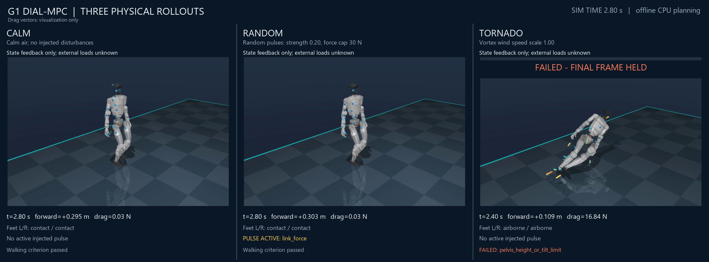
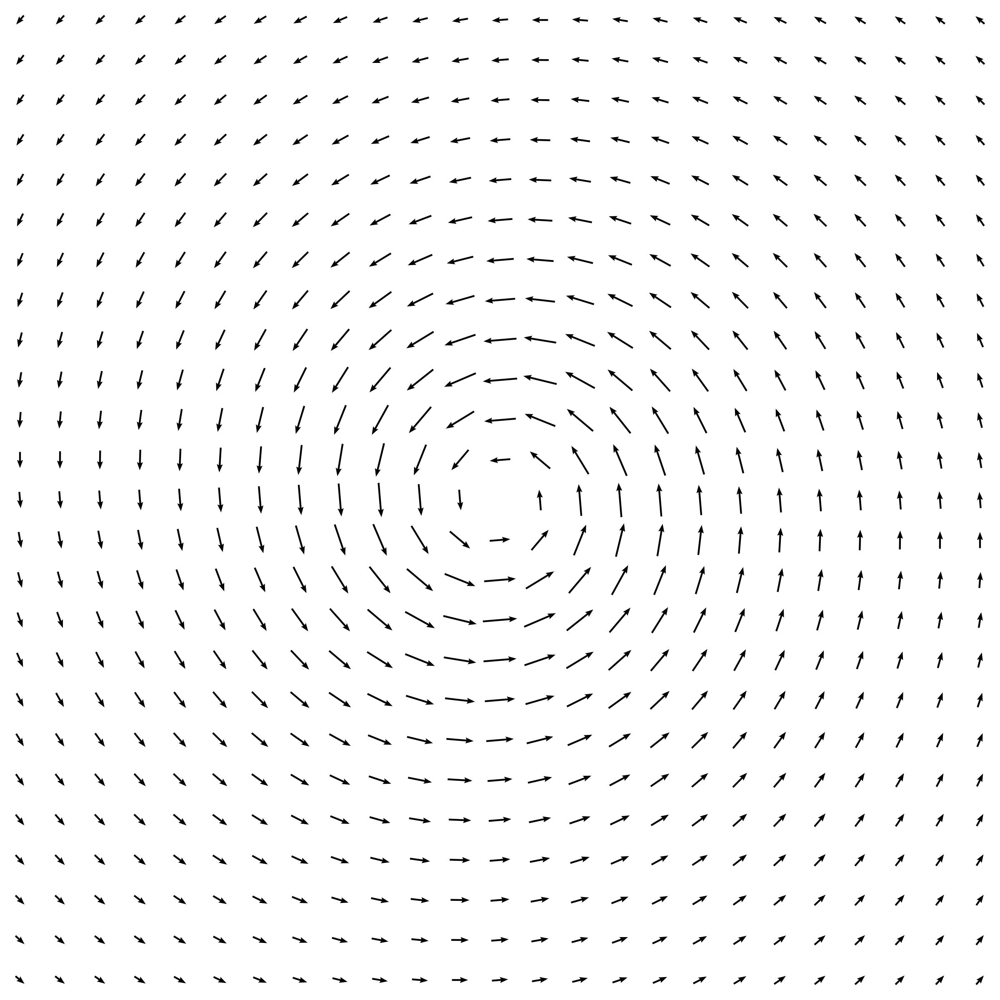

# G1 walking robustness under disturbances and wind

ROB6323 Optimal Control & Reinforcement Learning course project: physical G1
walking under joint/link disturbances and wind. The current executable
controller is our **G1 adaptation based on DIAL-MPC**, with no learned policy required.
Selecting and fine-tuning an RL walking policy remains a separate experiment.

This is an independently implemented adaptation, **not the unchanged official
implementation or a reproduction of the paper's benchmark**. Read the
[implementation differences and verification limits](mpc/UPSTREAM.md) alongside
the paper; the current tests do not establish numerical or behavioral equivalence
to upstream.

## Local output videos

Generated outputs belong in the Git-ignored top-level `outputs/` directory.
The latest videos on this checkout are in
`outputs/dial_mpc/unknown_disturbances/`: `comparison.mp4`, `calm.mp4`,
`random_disturbances.mp4`, and `wind_field.mp4`. Earlier force-informed
videos are separately labeled under `outputs/dial_mpc/historical_known_loads/`.
These local files are not downloaded by cloning the repository. The selected
published copies linked below remain in `mpc/assets/`.

New `python -m mpc --video` runs default to `outputs/dial_mpc/demo/`, with
each case's video at `<case>/walking.mp4` alongside its states and logs.

The local four-case video is
`outputs/dial_mpc/unknown_disturbances/comparison_2x2.mp4`, ordered as calm,
random impacts, large impacts, and wind field. Its numerical results are in
`comparison_2x2_results.json` in the same folder. These generated files stay
Git-ignored. The large-impact source run is under
`outputs/dial_mpc/large_impacts/random/`.

The large trial uses the same seed, controller, initial state, event times,
targets and directions as the earlier random trial, with pulse amplitudes
multiplied by five (`--disturbance-strength 1.0` versus `0.2`). Its actual
peak link force was 137.835 N, and it terminated at 3.40 s after crossing
both pelvis-height and tilt limits. It did not pass the walking check.
The other three trajectories are reused; they were not rerun or retuned.

**What the arrows mean:** they show aerodynamic surface drag, not injected
impacts. Calm air still produces small drag on moving limbs because relative
air velocity is `wind_velocity - surface_velocity`; the calm trial's peak
total drag is 0.042 N. Local arrows are scaled independently for each clip,
so their lengths should not be compared between cases. Random impacts are
finite-duration forces/torques at selected link centers of mass or hinge
joint torques, not surface collisions. The 2x2 video reports their recorded
target and magnitude separately in text.

## Current status

- Actual floating-base **Unitree G1, 29 actuators**, MuJoCo contacts and a
  10 m x 10 m flat test patch. Actions move physical joints.
- Gymnasium task, seeded disturbance schedules, training-only domain
  randomization, SB3 PPO checkpoint continuation and paired-seed evaluation.
- Surface-integrated aerodynamic loads, spatial/time-dependent winds, and
  the existing drag-only visualization with 50% robot transparency.
- **A pretrained walking policy has not yet been selected or integrated.**
  The PPO harness uses a project-native interface. Smoke training verifies
  execution, not walking ability. SONIC and Unitree RSL-RL weights require
  their original training stack and a tested adapter.
- **DIAL-MPC is implemented in `mpc/`.** It uses dual annealing, native
  full-order MuJoCo rollouts, and a G1-specific gait objective. The CPU
  demonstration runs synchronously offline; it does not claim real-time
  performance. Its runtime input is only robot time, position and velocity;
  external impacts are unknown to the planner. [Method and port details](docs/dial_mpc.md).

The earlier [policy-selection notes](docs/policy_selection.md) document
candidate frameworks; no checkpoint choice is final. Current terrain is flat.
Neither rough-terrain performance nor hardware transfer has been established.
The [experiment protocol](docs/experiment_protocol.md) separates the required
PPO comparison, optional ablations and later research claims.
The full suite passes **92 tests**, including a regression that changes or
invalidates force, field, event and solver-warm-start data while holding the
allowed observation fixed. See [validation results](docs/validation.md).

## DIAL-MPC with unknown external impacts

The controller receives `RobotObservation(time, qpos, qvel)` and predicts
with a load-free nominal model. It does not receive aerodynamic or injected
forces, wind-field data, event schedules, or the plant solver's internal
warm-start state. The controller stores no reference to the environment.
It responds to disturbances through their effects on the observed motion.

**Calm walking and the random-pulse trial completed; the full-strength wind
trial failed after 2.40 s.** All three use the same initial state, seed 7,
controller settings and unknown-load observation interface.

[Watch the unknown-disturbance comparison](mpc/assets/unknown_disturbances/comparison.mp4).
Individual videos: [calm](mpc/assets/unknown_disturbances/calm.mp4),
[random disturbances](mpc/assets/unknown_disturbances/random_disturbances.mp4),
[wind field, including the failure](mpc/assets/unknown_disturbances/wind_field.mp4).



| Case | Executed / requested time | Forward travel | Planar velocity RMSE | Walking check |
| --- | --- | --- | --- | --- |
| Calm | 4.00 / 4.00 s | 0.502 m | 0.245 m/s | Passed |
| Six random joint/link pulses | 4.00 / 4.00 s | 0.510 m | 0.230 m/s | Passed |
| Full configured vortex | 2.40 / 4.00 s | 0.109 m | 0.880 m/s | **Failed** |

The wind case drifted laterally by 1.337 m and terminated when pelvis height
fell to 0.440 m, below the 0.45 m limit. The tilt threshold was not the trigger.
Peak modeled aerodynamic force was 25.58 N. This is a failure of this G1
configuration and planning budget on this trial, not evidence that DIAL-MPC
generally cannot handle wind. The other two short single-seed successes do
not establish a broad robustness benchmark. The
[result bundle](mpc/results/g1_unknown_disturbances.json) preserves exact
metrics, settings and events. Mean CPU planning times were 1.19-1.32 s per
0.02 s control interval; these demonstrations are not real-time control.

The earlier [comparison video](mpc/assets/comparison.mp4) and
[results](mpc/results/g1_demo.json) are **historical privileged-load
demonstrations**: the planner could read the current aerodynamic link
wrenches. Their successful short trials must not be presented as evidence
for unknown external impacts.

The DIAL code uses only `requirements.txt`; no Torch, JAX or RL checkpoint is
needed. After installing those dependencies, run:

```powershell
.\.venv\Scripts\python.exe -m mpc --cases calm random tornado --duration 4 --controller-config mpc/configs/g1_demo.json --wind-scale 1 --disturbance-strength 0.2 --output outputs/dial_mpc/new_run --video
.\.venv\Scripts\python.exe -m mpc.compare outputs/dial_mpc/new_run/calm outputs/dial_mpc/new_run/random outputs/dial_mpc/new_run/tornado --output outputs/dial_mpc/new_run/comparison.mp4
```

Add the fivefold-impact condition and assemble a 2x2 comparison (use new
output folders if those paths already contain results):

```powershell
.\.venv\Scripts\python.exe -m mpc --cases random --duration 4 --seed 7 --controller-config mpc/configs/g1_demo.json --disturbance-strength 1.0 --output outputs/dial_mpc/large_run --video
.\.venv\Scripts\python.exe -m mpc.compare outputs/dial_mpc/new_run/calm outputs/dial_mpc/new_run/random outputs/dial_mpc/large_run/random outputs/dial_mpc/new_run/tornado --labels "Calm" "Random impacts" "Large impacts" "Wind field" --output outputs/dial_mpc/new_run/comparison_2x2.mp4
```

The runner returns exit status 1 when an episode terminates early; it still
saves that failure and renders it with `--video`. Comparison videos hold
the actual final frame after termination and do not invent later motion or
scheduled impacts.

Allow several minutes per case on a CPU. `--video` renders the actual
integrated trajectory with 50% robot opacity and aerodynamic drag vectors.
Random injected loads are separately captioned. Each case records the exact
compiled model, states, physical loads, contact events, planning latency and
failure status; existing output directories are never overwritten.

The demo config uses 64 sampled candidates per refinement, three refinements,
and a 0.4 s horizon. It optimizes the 12 leg-joint references around an IK gait
prior while integrating the entire floating-base 29-actuator G1. Upper-body
targets hold their reference posture. The prior is never imposed on the
physical state. This is an explicit G1 adaptation of the paper's optimizer,
not a reproduction of the upstream H1 benchmark or a kinematic walking replay.

The former `wind_prediction="current_wrench"` mode is removed; old configs
requesting privileged load access are rejected. Physical surface drag and
random loads remain active, and their logs/visualizations are kept outside
the controller. At disturbance strength 0.2, random peak limits are 30 N
link force, 4 N m link torque and 6 N m joint torque; the actual sampled event
schedule is saved with every run.

Robot pose and velocity currently come from noiseless simulation state,
including floating-base pose/velocity. This is still an ideal state-estimator
assumption. A real robot needs an estimator; removing wind/force access does
not establish sim-to-real transfer. Videos show simulated time, with the
physical clock paused while the CPU planner computes each action.

## Install and verify

Python **3.12.14** is the tested interpreter, pinned in `.python-version`.
From the repository root, using [uv](https://docs.astral.sh/uv/):

```powershell
uv python install 3.12.14
uv venv --python 3.12.14 .venv
uv pip install --python .venv/Scripts/python.exe -r requirements-rl.txt
.\.venv\Scripts\python.exe -m unittest discover -v
```

Alternatively create a venv with an installed Python 3.12.14 and use pip.
Avoid Python 3.12.0: local testing reproduced a nested ZIP reader failure
when reloading SB3 checkpoints, resolved with 3.12.14. A save/load regression
test covers this path. On Linux/macOS use `.venv/bin/python` in the commands.
The CPU environment needs no Unitree
SDK. `requirements.txt` alone installs simulation/visualization dependencies.
The selected upstream GPU training framework will need a separate install.

These short runs verify training, saving/loading and continuation. They do
**not** produce a competent walking policy. Use new or empty output folders:

```powershell
.\.venv\Scripts\python.exe -m rl.train --from-scratch --timesteps 512 --n-steps 128 --batch-size 64 --epochs 2 --output rl/runs/smoke
.\.venv\Scripts\python.exe -m rl.train --checkpoint rl/runs/smoke --timesteps 256 --n-steps 128 --batch-size 64 --epochs 2 --output rl/runs/smoke_continued
.\.venv\Scripts\python.exe -m rl.evaluate --checkpoint rl/runs/smoke --checkpoint rl/runs/smoke_continued --stand --scenarios calm tornado --episodes 1 --duration 2 --output rl/evaluations/smoke
```

For a **compatible, validated walking checkpoint**, begin fine-tuning at low
disturbance strength, then increase it while checking nominal walking:

```powershell
.\.venv\Scripts\python.exe -m rl.train --checkpoint rl/runs/walking_baseline --preset train_random --curriculum-strength 0.1 --timesteps 1000000 --output rl/runs/robust_stage1
```

`--from-scratch` must be explicit. Continuation loads PPO weights/optimizer
state and observation normalization, leaving the source bundle unchanged.
Bundles contain `model.zip`, `vecnormalize.pkl` when used, and `manifest.json`
with interface, hashes, settings, seed, versions and robot provenance.
Incompatible or incomplete bundles fail before training starts.

## Environment and loads

All environment and physics code lives in `sim_env/`:

```python
import numpy as np
from sim_env.rl_config import RLConfig
from sim_env.rl_env import G1RobustEnv

env = G1RobustEnv(RLConfig.preset("train_random"))
observation, info = env.reset(seed=42)
observation, reward, terminated, truncated, info = env.step(
    np.zeros(env.action_space.shape, dtype=np.float32)
)
env.close()
```

The **99-value observation** contains body-frame base linear/angular velocity,
projected gravity, commanded velocity/yaw rate, joint positions relative to
nominal, joint velocities and the previous requested action. Wind and
disturbance labels are excluded. Base velocity comes from simulation; real
deployment needs an estimator. The **29 normalized actions** specify joint
position offsets. `env.schema()` records exact joint order, nominal targets,
scales and limits. Physics runs at 500 Hz; control at 50 Hz.

Training randomizes mass/inertia, friction, actuator gains, sensor noise and
action delay. Nominal model parameters are restored at reset. The manual
`curriculum_strength` setting in [0,1] scales randomization and disturbances;
it does not automatically advance based on performance. Evaluation disables
training domain/noise randomization.

Schedules are sampled once at reset with independent RNG streams. The same
seed produces the same events regardless of policy actions or survival.
Default full-strength half-sine pulses last 0.1-0.35 s, with peaks up to
150 N link force, 20 N m link torque or 30 N m joint torque. These are
configurable stress-test bounds, not calibrated tornado loads. Link wrenches
use world axes at link CoM; joint torques act only on actuated hinge DOFs.
Loads are additive with wind and applied at every physics step. They expire
without resetting velocity.

`train_random` disables aerodynamics (`drag_model="none"`) for throughput.
Wind evaluation integrates surface drag. Calm air still resists moving
surfaces, so it differs physically from disabling drag.

## Evaluation protocol

```powershell
.\.venv\Scripts\python.exe -m rl.evaluate --checkpoint rl/runs/walking_baseline --checkpoint rl/runs/robust_stage1 --episodes 20 --seed 10000 --save-rollouts --output rl/evaluations/comparison
```

The default suite includes calm, uniform, gust, original tornado, shifted
vortex, reversed vortex and a smaller core. `--scenarios` also accepts
`shear`, `moving_vortex` and `random_push`. Controllers receive identical
scenario configurations and seed lists; evaluation normalization is frozen.
Small initial joint offsets (0.005 rad standard deviation by default) vary
across seeds, with identical initial states for each compared controller.
These trials measure initial-state uncertainty, not a distribution of all
possible storms. Fields use the declared scenario parameters. Keep training,
validation and final-test seeds separate. Use `--config` to select a common
RLConfig JSON; otherwise the first checkpoint supplies the common interface.
Held-out scenarios use full perturbation strength regardless of the training
curriculum stage.

Reports measure survival, failure, progress, velocity/yaw tracking error,
walking success and controller computation time. Success requires finishing
without failure, at least 60% of commanded travel, velocity RMSE below
0.25 m/s and yaw-rate RMSE below 0.5 rad/s. Standing still does not pass.
These are initial project thresholds, not a robotics benchmark standard.

Outputs: `results.json` with settings/event schedules, `episodes.csv`,
`summary.csv`, and optional NPZ states/actions. External controllers use
`--plugin module:factory` and declare their information access. Planning
time excludes physics/rendering; offline success does not prove real-time
operation. See [DIAL-MPC integration](docs/dial_mpc.md).

## Wind and visualization



The map spans 100 m x 100 m. The test patch is at world
`x=[68,78], y=[45,55]`; local positions are translated by `(68,45)`.
Arrow length is proportional to speed.

```powershell
.\.venv\Scripts\python.exe -m sim_env.plot_field --style arrows-bw
.\.venv\Scripts\python.exe -m sim_env.g1_physics --duration 2 --wind-scale 1 --drag-model surface --viewer
.\.venv\Scripts\python.exe -m rl.render --stand --scenario tornado --duration 2 --output rl/evaluations/tornado.mp4
```

`rl.render` records actual physical motion and draws aerodynamic vectors with
50% robot opacity. Replace `--stand` with `--checkpoint <bundle>` to render a
compatible PPO policy. MP4/JSON/NPZ outputs preserve physical states, forces
and experiment settings; injected joint/link perturbations are not mislabeled
as drag. Existing outputs are never overwritten.

Surface drag integrates windward normal-pressure loads over moving G1
meshes, with 4,096 area-weighted samples by default. Relative wind includes
each sample's translational/rotational velocity; forces and moments act on
each link. This is an **uncalibrated aerodynamic approximation, not CFD**:
no wake shielding, suction, resolved turbulence or fluid feedback. The
synthetic vortex is not a measured tornado.

The command above is a physical standing diagnostic. Earlier LQR walking
videos are kinematic replays. Their commands and the full drag visualization
method are preserved in [legacy simulation notes](docs/legacy_simulation.md).

## Source layout and provenance

| Path | Purpose |
| --- | --- |
| `sim_env/rl_env.py`, `rl_config.py` | Full-body Gymnasium task/settings |
| `sim_env/disturbances.py` | Reproducible joint/link perturbations |
| `sim_env/wind_fields.py`, `surface_drag.py` | Wind and distributed loads |
| `sim_env/visualize/` | Existing drag-only rendering tools |
| `mpc/` | DIAL-MPC controller, strict robot-state observation, physical demonstrations |
| `rl/` | PPO, checkpoint contracts, paired evaluation |
| `docs/` | Policy selection and baseline integration |
| `lqr/` | Preserved reduced-model homework experiment; outside current comparison |

G1 assets and upstream license are vendored from
[MuJoCo Menagerie](https://github.com/google-deepmind/mujoco_menagerie/tree/370c43965323c0944b433b202aac5058b5f907a9/unitree_g1).
`sim_env/models/unitree_g1/ASSET_MANIFEST.json` records source hashes.
Raw generated runs, logs and checkpoints are ignored by Git. Required robot
assets, proposal figures, and selected demonstration videos/results are included.
